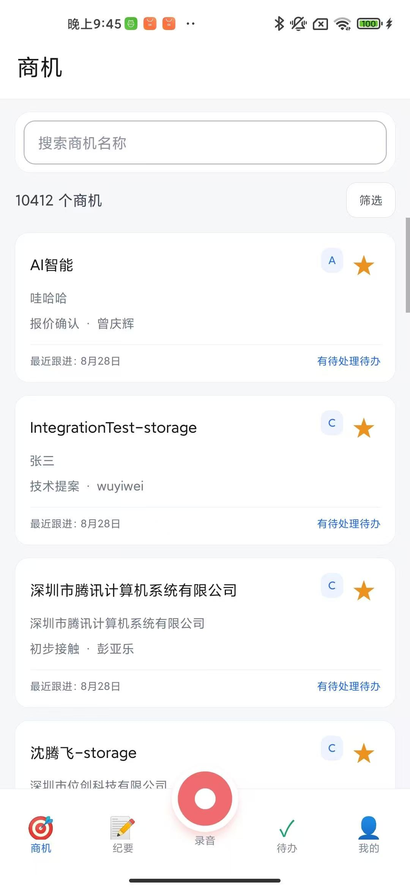
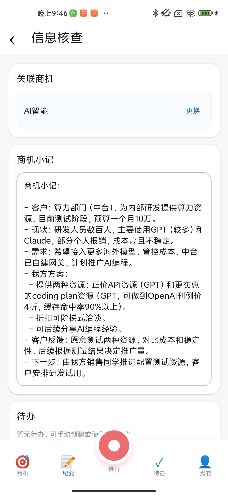
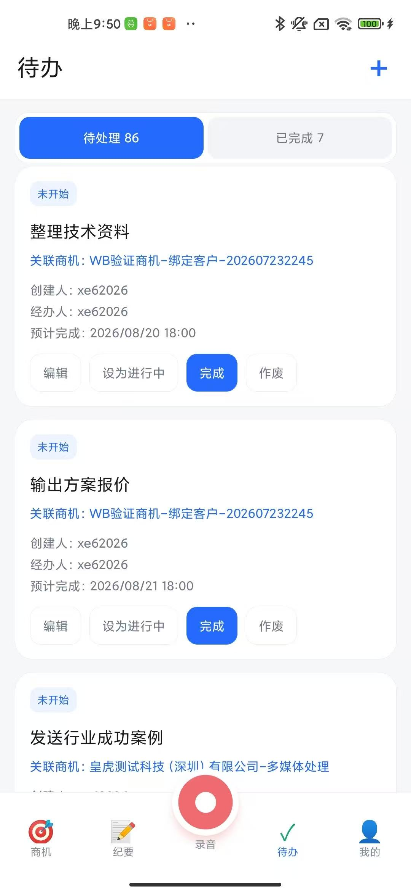

# 七牛商机助手

面向销售移动办公场景的 AI 商机管理与协同跟进应用。

**将客户沟通材料转化为可核查的商机小记与可分派的跟进任务，并经人工确认写入 CRM。**

本仓库展示陈隽鹏在七牛云实习期间参与设计与独立承担全栈研发的移动端产品成果，包括产品方案、关键设计决策、总体架构及真机操作截图。仓库为个人项目成果展示，非七牛云官方开源项目，不包含企业业务源代码、部署配置或可直接连接内部系统的服务。

## 产品概览

销售人员在外出拜访、客户会议和现场沟通中，需要及时记录客户需求、回看商机背景并安排后续工作。七牛商机助手将商机、纪要草稿、录音与待办放在同一移动端工作流中，支持从信息采集到业务落库、再到任务执行的连续操作。

| 商机管理 | 沟通纪要 | 协同任务 |
| --- | --- | --- |
|  |  |  |

## 核心能力

- **移动商机管理**：商机搜索与筛选、星标设置及取消、基本信息查询、历史小记查阅、原始材料回看、关联待办管理。
- **低操作负担的信息采集**：各业务页面均可通过中央录音键快速录制，支持暂停、取消与完成；也可直接上传录音文件、补充口述或文本材料。
- **AI 信息整理**：语音转写与说话人分离、转写核查、商机小记生成、待办一键提取及人工补充。
- **可控的业务写入**：关联商机、编辑小记和待办、集中预览内容与材料来源，经确认后写入 CRM。
- **草稿隔离与结果复用**：已有录音时快捷录音自动新建草稿；材料变化后复用未受影响的解析结果，更新依赖旧材料的生成内容。
- **任务分派协作**：创建者可以设置和调整经办人；用户集中查看自己创建或经办的任务，支持期限管理与状态流转。

## 完整业务流程

提交入库前可返回前序阶段修改；已经完成且未受材料变化影响的解析结果保留。**确认入库后不提供本流程内的撤销。**

## 个人承担与设计贡献

实习岗位为 AI 产品工程师实习生（全栈研发），实习时间为 2026 年暑期。基于既有 Opportunity Web CRM，独立承担移动端产品方案、技术架构与数据模型设计，以及客户端、服务端开发、接口联调、真机测试与交付。

重点设计贡献包括：

1. 提出与商机关联的协同任务模式，以创建人与经办人分离支持跨人员分派，并按两类关系组织个人待办。
2. 提出材料级解析结果复用与下游结果更新机制，处理材料变更后的重复解析、等待及旧内容残留问题。
3. 设计全局快捷录音与草稿隔离路径，支持现场先采集、后整理，避免不同次沟通录音混入同一草稿。
4. 完成 AI 能力与 CRM 业务链路集成，通过人工核查、来源保留和写入预览提高结果的可核验性。

## 工程实现

| 层次 | 技术与职责 |
| --- | --- |
| 移动客户端 | React Native、TypeScript；商机、纪要、录音与待办交互 |
| 服务端 | Go、Gin、GORM；CRM API 扩展、业务处理与接口集成 |
| 数据与任务 | MySQL、MongoDB、Redis、Asynq；业务数据、材料元数据及异步任务处理 |
| 文件与材料 | 七牛对象存储、FFmpeg、OCR、Tika；材料存储、音频处理与文本化 |
| AI 集成 | ASR、说话人分离、LLM；录音转写、纪要生成与任务提取 |
| 工程可靠性 | 多草稿管理、上传进度、幂等写入、任务重试与异常恢复 |

技术栈来自项目经历记录。总体架构图属于早期设计，不将其中每个逻辑服务等同于已独立部署的微服务。

## 交付与数据规模

已完成多轮真机联调、端到端测试与交付，产品具备供销售人员实际使用的业务功能。面向万级至十万级以上商机数据的业务背景，开发环境对接并展示了 **10,412 条商机**。本仓库截图来自开发环境，不将开发数据量表述为生产部署规模或性能压测结论。

## 阅读导航

| 材料 | 内容 |
| --- | --- |
| [完整产品设计方案](docs/product-spec.md) | 当前功能范围、模块行为、流程、材料变更规则及验收清单 |
| [关键产品与工程决策](docs/design-decisions.md) | 设计动机、取舍、场景例子及个人贡献 |
| [总体架构说明](docs/architecture.md) | 用户提供的原始架构图、技术栈与当前版本差异 |
| [完整截图演示](docs/walkthrough.md) | 18 张原始截图，按模块与业务步骤编排 |
| [版本演进对照](docs/evolution.md) | 早期方案与当前已确认能力的逐项差异 |
| [早期产品设计原稿](archive/early-product-spec.md) | 原文留档，用于展示设计演进，不作为当前功能清单 |

## 材料说明

本仓库基于作者提供的早期设计文档、总体架构图、项目经历记录、开发环境截图及后续功能说明整理。产品设计方案按已确认行为更新，不代表从源码自动生成的接口文档。未确认的早期规则任务、字段回写与未来演进能力均单独标注。截图中的示例商机名称、预算、报价或沟通数字属于页面内容，不是本项目的收入、客户规模或效率指标。

文档整理日期：2026 年 11 月 5 日。原始截图及架构图保持原样，公开范围由作者确认。仓库未附开源许可证，不对企业系统或相关材料另行授予使用许可。
