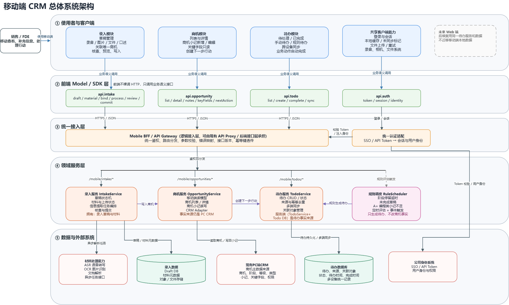

# 总体架构说明

## 原始总体架构图

以下直接使用作者提供的原始架构图，保持图片内容不变。它属于早期设计，展示系统分层与职责规划；当前产品行为以 [新版产品设计方案](product-spec.md) 为准。

[查看原尺寸图片](../assets/architecture/original-system-architecture.drawio.png)

## 分层思路

| 层次 | 原图职责 | 当前展示中的对应关系 |
| --- | --- | --- |
| 使用者与客户端 | 录入、商机、待办及共享端能力 | 商机、纪要、中央录音与待办页面 |
| 前端 Model／SDK | 按业务语义封装录入、商机、待办及认证接口 | 客户端承载各模块交互；具体 SDK 命名与方法清单属于早期设计 |
| 统一接入层 | 路由、鉴权、参数处理、错误映射及认证适配 | 作为逻辑接入职责解释，不声明另行部署了独立网关产品 |
| 领域服务层 | 录入服务、商机服务、待办服务及规则调度 | 录入、商机、协同待办为当前核心；规则调度仍按历史规划标注 |
| 数据与外部系统 | 材料处理、草稿及材料存储、PC CRM、待办存储、身份系统 | 对应 AI 处理、材料留存、商机读写与任务持久化等职责 |

图中的服务边界是逻辑职责边界，不等同于每个模块都已拆成独立部署的微服务。图中路径和接口方法是早期规划名称，不作为最新版 API 文档。

## 当前技术栈

客户端使用 React Native 和 TypeScript。服务端基于 Go、Gin 与 GORM 扩展既有 CRM API，结合 MySQL、MongoDB、Redis、七牛对象存储及 Asynq 异步任务处理。材料链路集成 ASR、说话人分离、OCR 与 LLM，并通过 FFmpeg、Tika 处理音频及文档输入。

以上来自作者项目经历记录；未提供最新版部署清单，因此不推定各数据库与业务实体的一一对应，也不补写实例数量、网络拓扑或容量配置。

## 与当前产品的差异说明

| 原图内容 | 阅读时的修正说明 |
| --- | --- |
| 手动待办／规则待办、规则调度器 | 当前已确认的是手动创建、商机内创建与 AI 提取待办；规则调度未确认上线 |
| 业务动作自动完成 | 当前已确认任务状态操作；不将草稿提交自动完成任务等早期规则写为当前成果 |
| 商机关键字段只读 | 当前展示基本信息；自动提取并回写主字段未确认实现 |
| 商机小记新增／编辑 | 当前确认新增及入库前编辑；历史小记原地编辑不由截图推断 |
| 录入模块核查、预览、写入 | 需要结合新版理解为转写核查、小记生成、待办提取、信息核查与提交前预览 |
| 未来 Web 端复用待办 | 保留为架构演进方向，不声明 Web 待办已交付 |
| 未展开草稿复用与任务分派 | 当前产品增加了草稿隔离、材料级解析复用、下游结果更新及创建人／经办人协同机制 |

原图无需为本次展示重新绘制，通过这份说明与新版产品方案配套阅读，既保留早期设计成果，也避免误读当前交付范围。
