# 七牛商机助手完整截图演示

以下为作者提供的 18 张原始真机截图，按模块与完整业务过程编排。截图来自开发环境，已获作者确认可公开。图片未改动，部分截图包含开发样例与测试数据。

[返回项目首页](../README.md) · [查看完整产品方案](product-spec.md)

## 1 应用入口

七牛商机助手已安装于真机。该截图用于识别产品名称，不作为上架应用商店的证明。

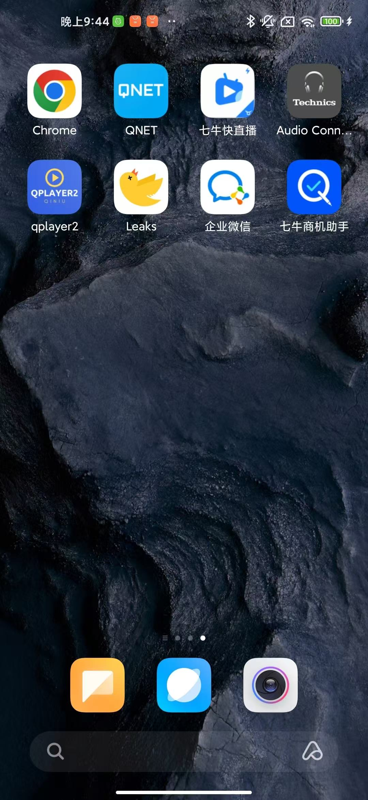

[查看原图](../assets/screenshots/app-icon.jpg)

## 2 商机检索与概览

展示名称搜索、筛选入口、10,412 条商机总数、阶段与等级、负责人、星标、最近跟进时间和待处理提示。截图为开发环境。

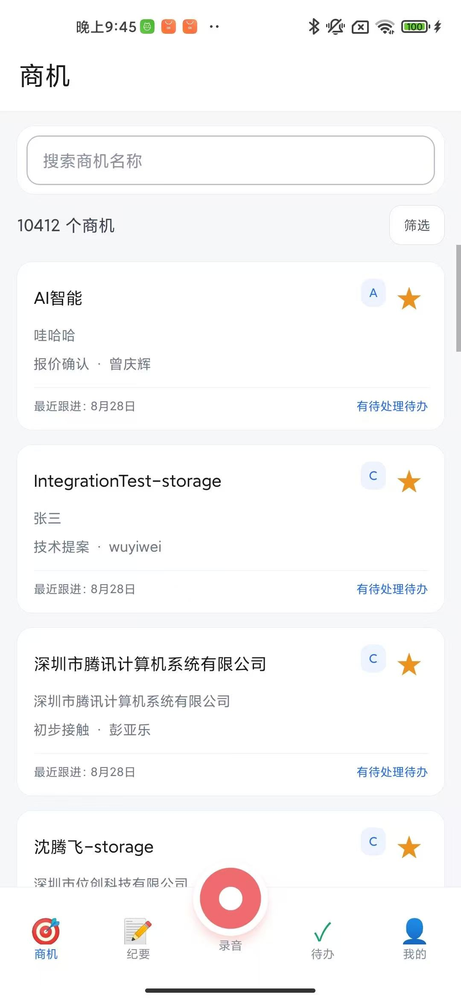

[查看原图](../assets/screenshots/opportunity-list.jpg)

## 3 商机详情与小记

展示商机基本信息、金额、产品需求，以及小记时间、记录人、业务类型和材料数量；可新增或查看小记。

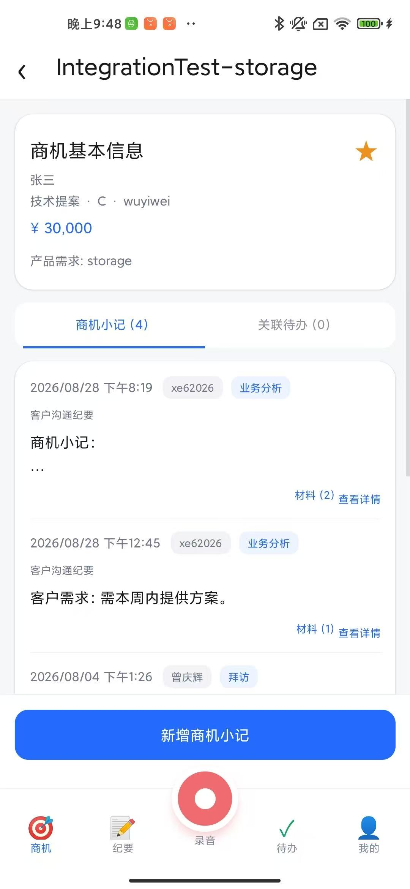

[查看原图](../assets/screenshots/opportunity-notes.jpg)

## 4 商机内的关联任务

在商机上下文内聚合待办，展示经办人、预计完成时间及状态操作。

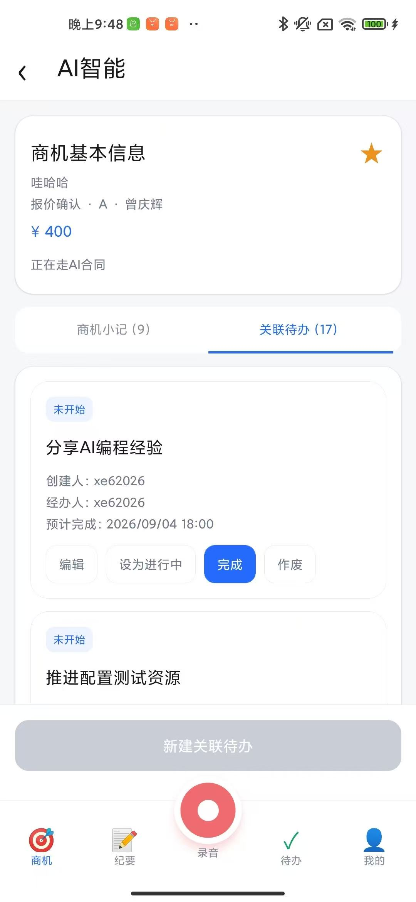

[查看原图](../assets/screenshots/opportunity-todos.jpg)

## 5 小记详情与原始材料

沟通小记与录音材料、转写原文共同展示，便于查阅业务结论及原始依据。

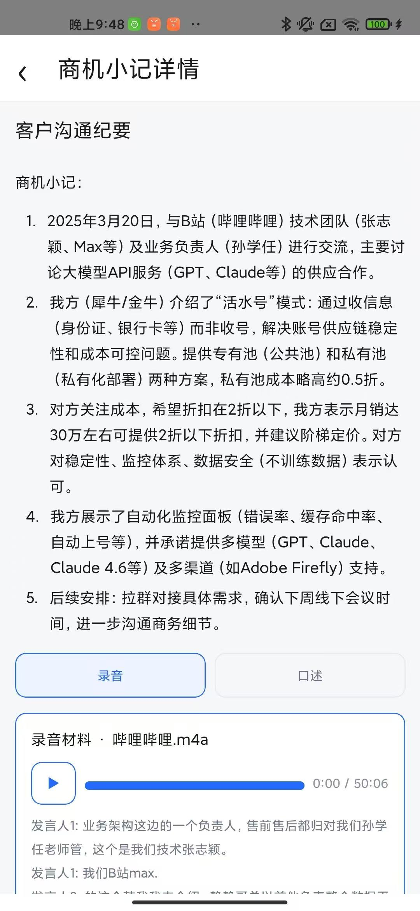

[查看原图](../assets/screenshots/note-detail.jpg)

## 6 待处理任务

用户可查看自己创建或经办的任务。卡片包含关联商机、创建人、经办人和预计完成时间，可编辑、设为进行中、完成或作废。

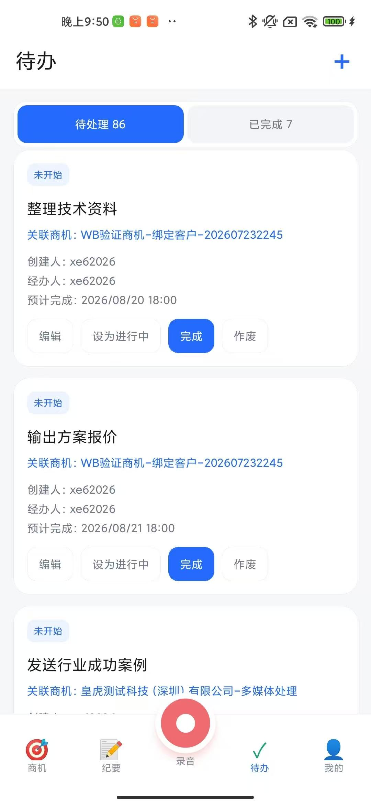

[查看原图](../assets/screenshots/todo-pending.jpg)

## 7 已完成任务

待处理与已完成分类展示并统计数量，已完成任务保留商机及人员信息。

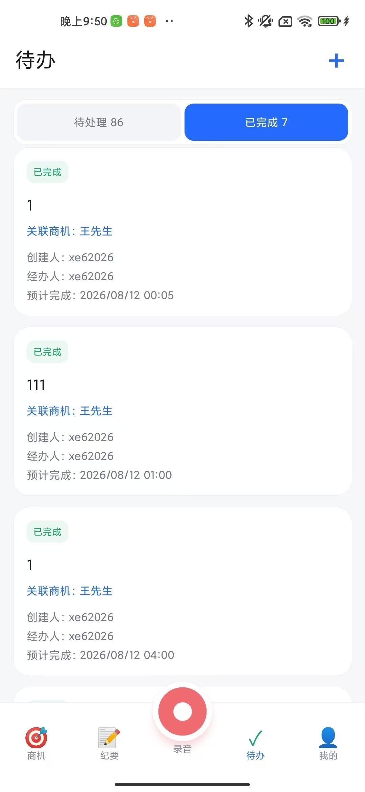

[查看原图](../assets/screenshots/todo-completed.jpg)

## 8 编辑与分派待办

编辑任务内容、经办人、预计完成日期与时间，并展示关联商机。作者确认经办人可改，支持将任务派给相关人员。

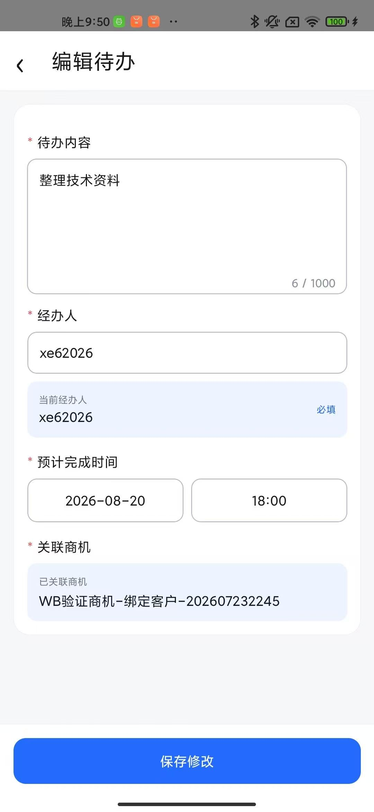

[查看原图](../assets/screenshots/todo-edit.jpg)

## 9 任意业务页面快捷录音

中央红色录音键打开录音弹层，支持计时、暂停、取消与完成。已有草稿录音时再次快捷录制会新建草稿，避免上下文混用。

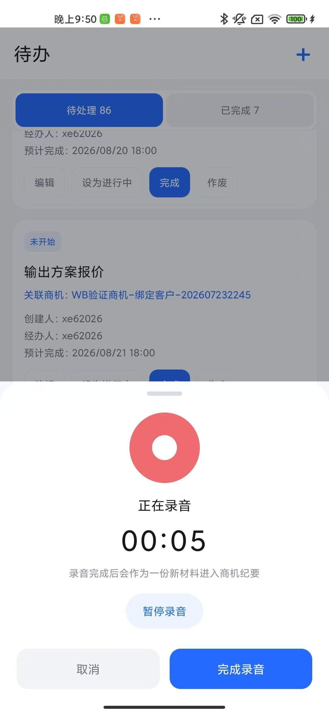

[查看原图](../assets/screenshots/quick-recording.jpg)

## 10 上传材料与草稿箱

纪要模块支持上传录音，显示文件名、时长与上传百分比；当前草稿和其他草稿分区展示。

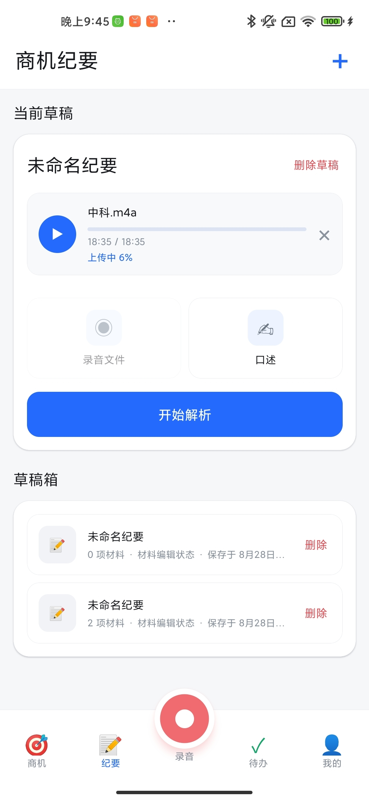

[查看原图](../assets/screenshots/material-upload.jpg)

## 11 材料留档与发起解析

上传后的材料显示已留档，可播放或移除，并可开始解析。补充入口包括口述。

[查看原图](../assets/screenshots/material-ready.jpg)

## 12 异步解析

解析中状态明确提示可切换其他页面，不要求用户停留等待。已解析且未受材料变化影响的结果会保留。

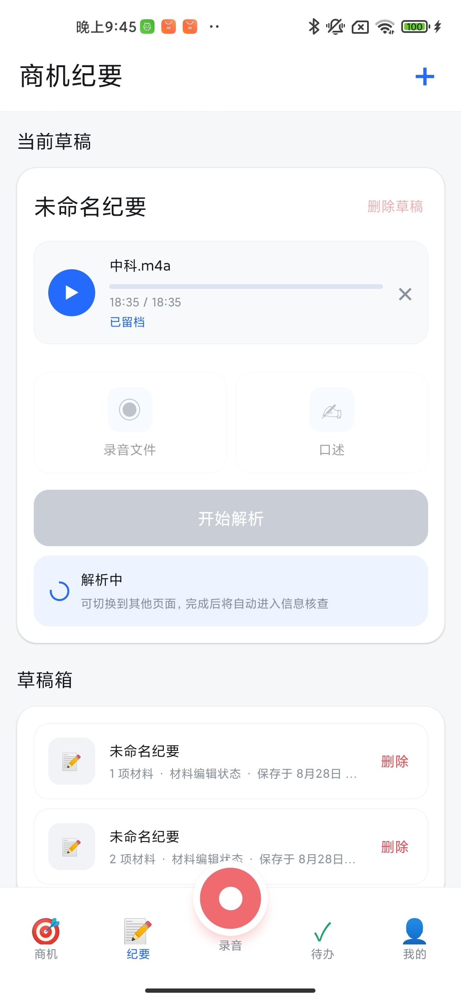

[查看原图](../assets/screenshots/material-processing.jpg)

## 13 转写核查

展示原始录音、会话人标识、带时间标记的分段转写，以及生成商机小记入口。开发样例中的非业务语音不作为识别准确率指标。

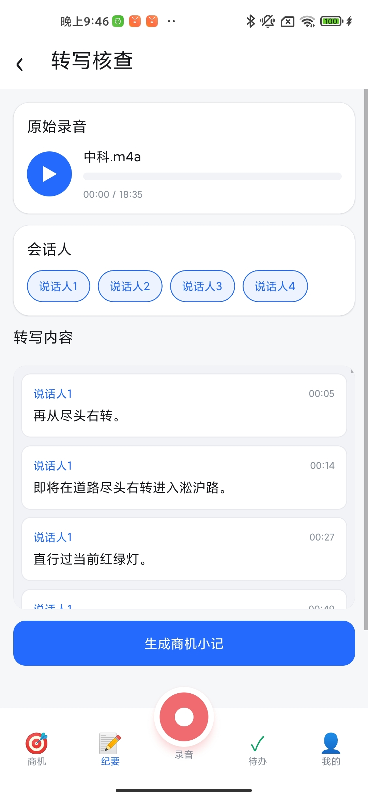

[查看原图](../assets/screenshots/transcript-review.jpg)

## 14 信息核查与商机关联

生成的小记可编辑，用户在此选择或更换关联商机。页面里的预算及商务数字仅为材料内容，不是本项目的成果指标。

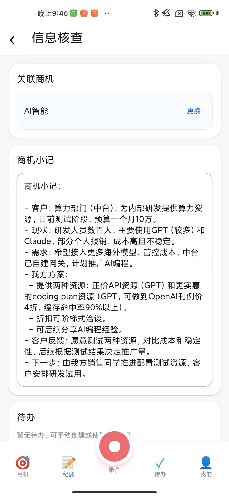

[查看原图](../assets/screenshots/information-review.jpg)

## 15 AI 提取与人工补充待办

支持 AI 一键提取和手动创建待办；提取后可编辑或删除任务，检查经办人及预计完成时间。

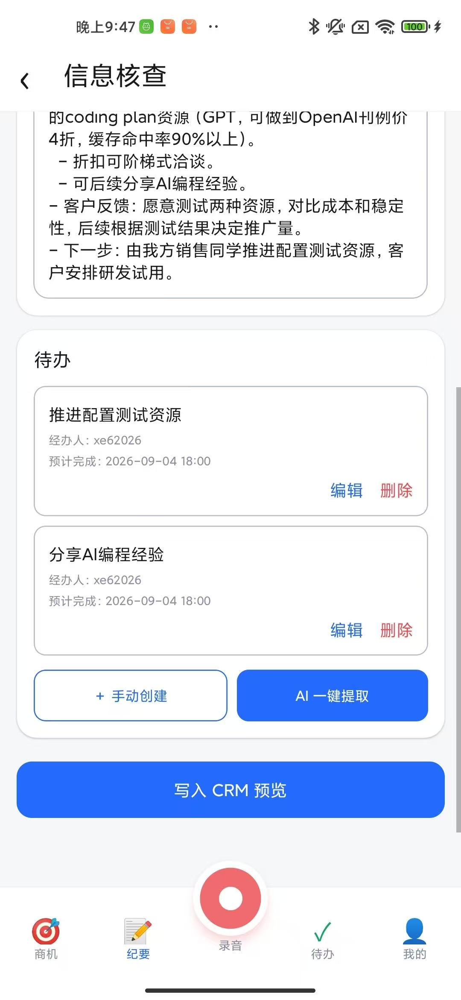

[查看原图](../assets/screenshots/todo-extraction.jpg)

## 16 写入 CRM 前预览

集中预览商机小记和拟创建任务，在提交前再次核对业务内容。

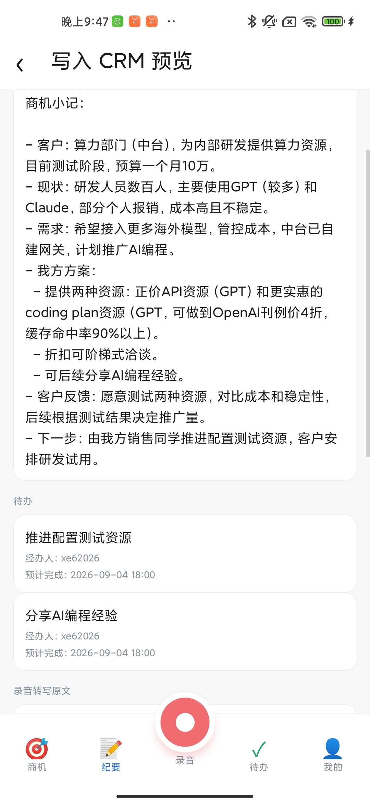

[查看原图](../assets/screenshots/crm-preview.jpg)

## 17 转写原文与材料来源

预览保留转写原文和材料来源，最终确认后写入 CRM。此前可回退修改，入库成功后本流程不提供撤销。

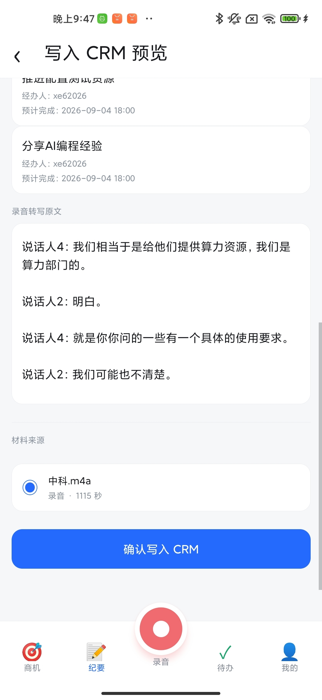

[查看原图](../assets/screenshots/crm-preview-source.jpg)

## 18 写入成功

成功反馈明确显示商机小记及 2 条待办已创建，当前草稿退出本次编辑流程。

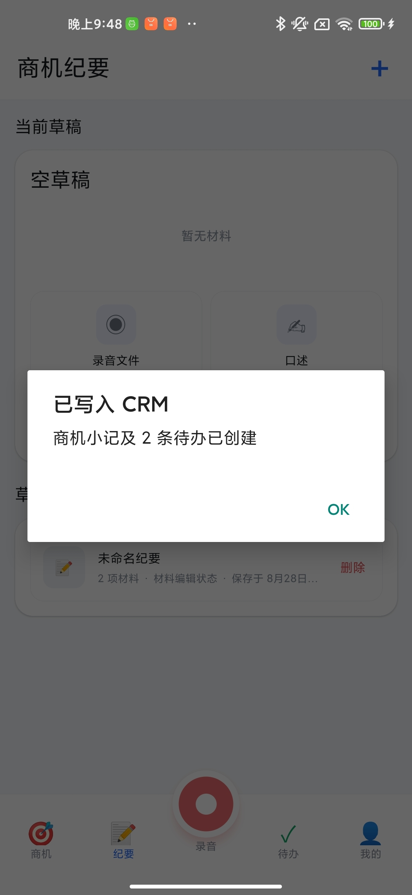

[查看原图](../assets/screenshots/crm-success.jpg)
